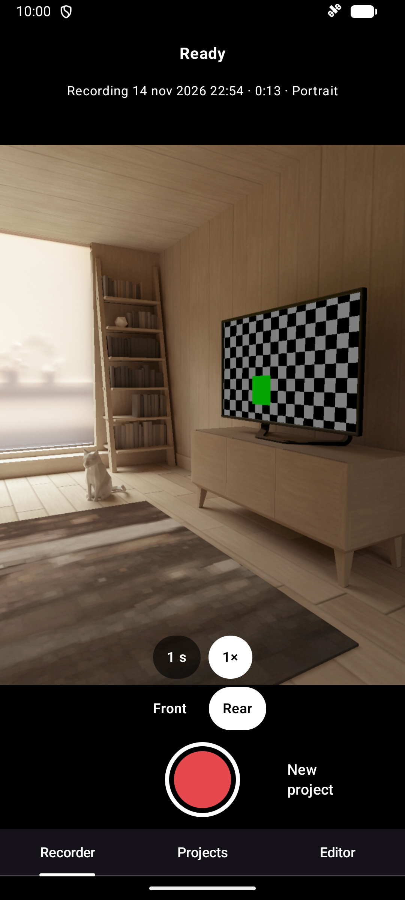
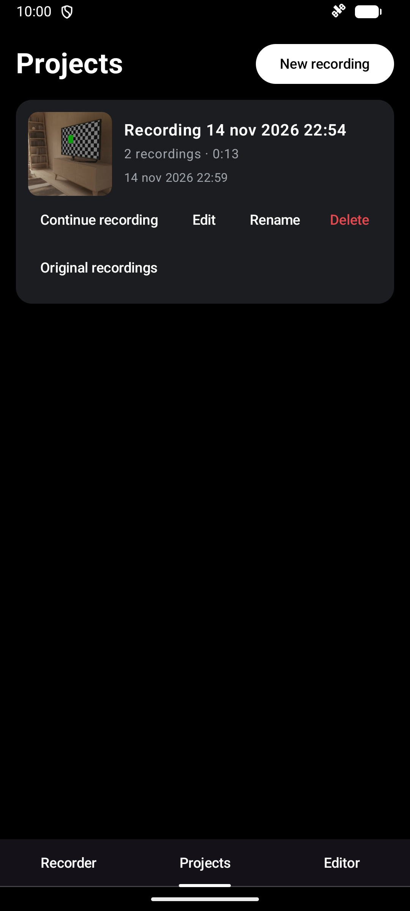

# Takes

A camera and video editor for Android: record a project take by take, then cut it,
grade it, add titles and sound, and export, all on the phone. Takes is a Kotlin
rewrite of [YouRec](https://github.com/antirez/YouRecApp), antirez's iPhone app. The
YouRec name and icon are reserved by its author, so this port has its own.

  
  
  

## Install

- [Google Play](https://play.google.com/store/apps/details?id=app.takes)
- or the APK attached to each [GitHub release](https://github.com/baldarn/takes-app/releases).
  The two are signed with different keys, so one cannot update the other.

Android 8 or newer. Recordings, projects and what is said in them stay on the device.
The app uses the network for one thing: downloading a model when you ask for it, the speech
model for subtitles (about 987 MB or 375 MB depending on the model, from Hugging Face) or
the model of a speech restoration stage of Enhance audio (LavaSR v2, about 56 MB from
GitHub; VoiceFixer, about 415 MB from Hugging Face).

Almost everything the original does is ported: of the 209 features inventoried in
[docs/PARITY.md](docs/PARITY.md), 192 work as in the original, 11 work with a difference
that Android imposes, and 6 are left out (listed under
[Differences from the original](#differences-from-the-original)).

## What it does

### Record

- Projects as the durable unit: record, pause, resume, stop, and continue the same project
  later, even after the app restarts. Each pause or stop finalizes one immutable take, and
  a take cut short by a crash comes back with its marks the next time the app opens.
- The large button stops and the round one beside it pauses, as in the original; leaving
  the app pauses the recording.
- Switch camera while recording, inside the same take; a lens menu with the main,
  ultrawide, tele and front cameras; zoom presets, timed zoom transitions up to 30 s,
  pinch to zoom, and a zoom remembered per camera.
- Dual camera, where the phone can run two cameras at once: both in one picture in four
  layouts, with the inset's shape, each feed's framing, and a swap.
- 1080p or 4K, HDR (HLG, ten bits) where the camera records it, capture stabilisation,
  Level horizon, Follow face, mirrored selfies, a front light on the screen's edge, tap to
  focus, focus lock, manual focus and focus peaking, each where the phone's camera has it.
- Live video effects while recording, with Crash Zoom and Dolly Zoom buttons and a tap to
  choose the subject; the take keeps what the recorder showed, so the editor opens it
  without analysing it again.
- Microphone choice and order of preference, its name and live level on screen, a warning
  when the sound comes from another input, and a recording gain per microphone.
- Bookmarks: one tap marks a moment while recording.
- Record here: from the editor, new takes go into the edit at the playhead, and one Undo
  takes the whole run back out.

### Edit

- A thumbnail timeline with waveforms under a fixed playhead, timeline zoom, full-screen
  preview, an inspection zoom on the picture, quick review, and review at up to 3× with the
  pitch kept.
- Split, trim, delete and reorder clips; select several; mark a range and delete, copy, cut
  and paste it, or apply a tool to just that part; snap to cuts; close gaps; undo and redo
  that survive closing the app.
- Independent picture and sound, any number of layers, overlapping videos placed as cover,
  side by side, top and bottom or picture in picture, and image overlays.
- Add videos and photos from the device at the playhead, or takes not used yet in a chosen
  order.
- The original's nine transitions between clips and at the start and end of the movie:
  dissolve, fade through a colour, wipe, split screen, Hitchcock, whip pan, flash cut, still
  and defocus, each with its settings and its own sound timing (J and L cuts).
- Titles that follow their footage, with the original's looks, seven font families plus the
  phone's own and imported fonts, solid or gradient fill, outline, shadow, a box behind the
  words, entrance and exit motion, and saved styles.
- Picture: speed from 0.25× to 4× with the pitch kept, crop, rotation and animated
  reframing, the project's shape (16:9, 9:16, 1:1, 4:5), mirror, stabilisation (Light,
  Standard, Strong), and colour: fourteen looks, imported `.cube` LUTs, exposure, warmth,
  tint, highlights, colour correction with keyframes, saved and animated grades, and Log
  footage converted for display.
- The original's video effects, from Noir and Bleach Bypass to Kaleidoscope, Quantization,
  film textures, time effects, Chroma Key, Auto Background, Color Isolation, Crash Zoom,
  Dolly Zoom and Night fix, with keyframes and each effect's film history.
- Sound: levels in half decibels with a warning when the mix would clip, fades, two audio
  tracks for imported music or voice, voice recording in the editor, noise reduction with
  RNNoise or DeepFilterNet3, speech detail restoration with LavaSR v2 and studio
  restoration with VoiceFixer (each model downloaded when you add its stage), a low cut,
  a voice EQ, an output gain, the censor beep, and
  Remove pauses, which finds a clip's silences and cuts them out as one Undo step.
- Subtitles: the speech is transcribed on the phone with Qwen3-ASR, the original's model,
  or with the lighter Whisper small (both through sherpa-onnx), in the language you choose
  or one it detects. Captions follow their footage and can be corrected, regrouped and
  styled with the full title inspector.
- Preview and export draw the picture, titles, transitions and effects with the same code.

### Export and share

- Export to a new movie in the project's `Exports` folder: original size, 720p, 1080p or 4K,
  H.264 or H.265, 24 to 60 fps, and HDR kept (HLG, H.265 ten bits). Sources are never
  modified.
- The movie is made in sections of twelve seconds: leaving the app pauses the export, and it
  goes on from the saved sections, also after the app was closed. The finished movie is
  checked (length, first and last picture, sound peaks), and an unchanged edit offers the
  movie it has instead of exporting again.
- Play, share or save to the gallery; share a frame as the cover.
- Zip project: the recordings, sounds, LUTs, fonts, editing history and the edit as an
  OpenTimelineIO file, in the form YouRec writes, so the same ZIP opens in Takes and in
  YouRec on iPhone; Takes opens YouRec's ZIPs too ([docs/IOS-INTEROP.md](docs/IOS-INTEROP.md)).
  A project the iPhone could not open, such as one with WebM or Ogg files, is zipped for
  Takes only, and the app says why. Not yet tried on an iPhone: reports are welcome.
- Duplicate a project; Recently Deleted with restore; a damaged project falls back to its
  previous revision.

In English and Italian, following the phone's language.

## Differences from the original

Left out: Apple Log capture and Cinematic-mode depth effects (Apple-only), the 16:9 front
selfie with the phone upright (an iOS sensor mode), and "Protect recording audio" (an iOS
audio session setting).

Different because of Android: the preview in the editor is SDR (the exported movie keeps
HDR), and an HDR export is ten bits drawn from an eight-bit pipeline; the recording codec
is CameraX's choice; faces are found by Android's detector, which sees frontal faces only;
before Android 13 the preview shows some transitions as dissolves. Every detail is in
[docs/PARITY.md](docs/PARITY.md).

## Build

Needs JDK 17, the Android SDK (API 36), and the NDK (29.0.14206865) with CMake 3.22.1 for
the native modules (`rnnoise`, `deepfilter`, `stabilization`).

    ./gradlew :core:test                        # the editing model, on the JVM (below)
    ./gradlew :rnnoise:testDebugUnitTest        # the noise-reduction C library
    ./gradlew :speech:testDebugUnitTest         # speech models; see speech/README.md
    ./gradlew :deepfilter:testDebugUnitTest     # DeepFilterNet3 noise reduction
    ./gradlew :stabilization:testDebugUnitTest  # video stabilisation
    ./gradlew :restoration:testDebugUnitTest    # LavaSR and VoiceFixer; see restoration/README.md
    ./gradlew :app:lintDebug                    # Android lint
    ./gradlew :app:assembleDebug                # app/build/outputs/apk/debug/app-debug.apk

All of them in one command, which is what the CI runs on every pull request:

    ./gradlew :core:test :rnnoise:testDebugUnitTest :speech:testDebugUnitTest :deepfilter:testDebugUnitTest :stabilization:testDebugUnitTest :restoration:testDebugUnitTest :app:lintDebug :app:assembleDebug

The first build downloads sherpa-onnx from its GitHub release and DeepFilterNet3's weights
from Hugging Face, each checked against a SHA-256.

`core` holds nearly all the tests: the editing model with the track timeline, the parity
sample and the golden projects. What each command covers, and the pixel tests that run on a
phone or an emulator (`scripts/pixel-tests.sh`), are in
[CONTRIBUTING.md, "Tests and lint"](CONTRIBUTING.md#tests-and-lint).

## Layout

- `core/` — pure Kotlin, no Android: the project model, the timeline and its editing, the
  formulas of the colour, effects, transitions, titles and audio, the project ZIPs and the
  YouRec codec (`yourec/`), with host tests.
- `app/` — Compose UI, CameraX, OpenGL and Media3: the recorder, the projects list, the
  editor, the preview and the export.
- `rnnoise/` — the RNNoise C library with a small Kotlin API.
- `deepfilter/` — DeepFilterNet3 noise reduction on the ONNX Runtime that sherpa-onnx brings.
- `stabilization/` — the original's motion estimator for the Stabilize tool, its own C++ source unchanged.
- `restoration/` — LavaSR v2 and VoiceFixer for Enhance audio: their downloaded models and
  their networks on the same ONNX Runtime; their signal processing is in `core/`.
- `speech/` — speech recognition for subtitles: Qwen3-ASR and Whisper through sherpa-onnx,
  the description of each model and the verified download of its files.
- `probes/` — standalone experiments that measured choices on real phones (export, layers,
  person segmentation).
- `docs/` — the parity inventory, plans and findings.

## Contributing

Issues and pull requests are welcome: [CONTRIBUTING.md](CONTRIBUTING.md) says how to
build, test and pick work, and what a pull request needs.

## License

MIT, like the original: see [LICENSE](LICENSE). The licenses of the bundled libraries
are in the app's Credits screen.
