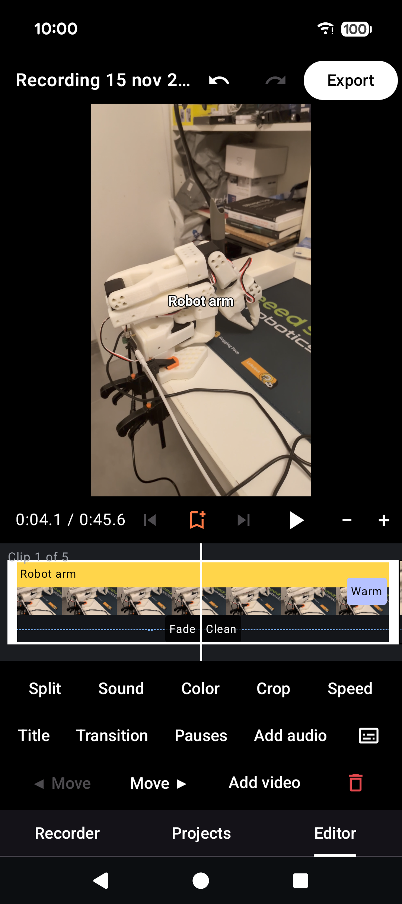

# Takes

A camera and video editor for Android: record a project take by take, then cut it,
grade it, add titles and sound, and export, all on the phone. Takes is a Kotlin
rewrite of [YouRec](https://github.com/antirez/YouRecApp), antirez's iPhone app. The
YouRec name and icon are reserved by its author, so this port has its own.

  
  
  

## Install

- [Google Play](https://play.google.com/store/apps/details?id=app.takes)
- or the APK attached to each [GitHub release](https://github.com/baldarn/takes-app/releases).
  The two are signed with different keys, so one cannot update the other.

Android 8 or newer. Recordings, projects and what is said in them stay on the device.
The app uses the network for one thing: downloading the speech model for subtitles (about
987 MB or 375 MB depending on the model, from Hugging Face) when you ask for it.

The port is still in progress. What works today is listed under
[What it does](#what-it-does), what is missing under [Not ported yet](#not-ported-yet).

## What it does

- Projects as the durable unit: record, pause, resume, stop, and continue the same
  project later, including after the app restarts. Each pause or stop finalizes one
  immutable segment file.
- Camera switching while recording, kept inside the same segment with a `camera` event.
- Per-camera zoom memory, zoom presets, timed zoom transitions and pinch to zoom, with
  the 1× lens offered from the ultrawide.
- Tap to focus, focus lock and manual focus where the camera has them; 4K, mirrored
  selfies, a front light and recorder settings, each offered only where the phone's
  camera supports it.
- The large button stops a recording and the round one beside it pauses, as in the
  original; leaving the app pauses the recording, and a recording cut short by a crash
  comes back with its marks when the app is opened again.
- Recordings stay outside editor undo/redo, as in the original model.
- Unused takes: footage that is in the project but no longer in the edit can be put
  back at the playhead, in a chosen order, as one Undo step.
- Record here: from the editor, new takes go into the edit at the playhead instead of
  at the end, and one Undo takes the whole run back out.
- Microphone choice on Android 12 or newer: automatic, the phone, or a Bluetooth, wired
  or USB headset, with a warning when the recording comes from a different input.
- English and Italian, following the phone's language.
- Basic editor: preview of the edit, scrolling thumbnail timeline under a fixed
  playhead with audio waveforms, split at the playhead, trim handles on the current
  clip, delete and reorder clips, persistent undo/redo.
- The original's nine transitions between neighboring clips and at the start and
  the end of the movie: dissolve, fade through a color, wipe, split screen,
  Hitchcock, whip pan, flash cut, still and defocus, each with its settings, a
  hold, and its own audio timing (J and L cuts). Picture and sound are identical in
  preview and export; before Android 13 the preview shows the styles that need a
  shader as dissolves.
- Titles attached to their footage, identical in preview and export.
- Title design and motion as in the original: its seven font families and the phone's
  own, solid or gradient fill, outline, shadow, a box behind the words or each line,
  alignment and spacing, entrance and exit (fade, drift, scale, wipe), placing by
  dragging, and channel styles saved for every project.
- Export of the edit to a new movie in the project's `Exports` folder, with a choice
  of size (original, 720p, 1080p, 4K), H.264 or H.265, and a 30 or 60 fps ceiling, then
  play, share or save to the gallery. Sources are never modified. A movie runs at one
  frame rate, the fastest footage's under the ceiling, and slower footage repeats frames.
  The movie is made in sections of twelve seconds that are kept as they are finished:
  leaving the app pauses the export, as in the original, and it resumes from the saved
  sections, also after the app was closed. The finished movie is checked (its length, its
  first and last picture, the loudest peak of its sound) and keeps a receipt, so an
  unchanged edit offers the movie it has in place of exporting again.
- Import of videos from the device through the system picker, into a new or an
  existing project. HDR footage is tone-mapped on export.
- Credits and licenses screen with the bundled license texts.
- Clip sound: volume from silence to a 12 dB boost, mute, and a fade in and out,
  shown on the waveform and applied in preview and export.
- Sound on two separate audio tracks: import a music or voice file, place it at the
  playhead, cut it, move it, set its level and fades. It stays where it is when the
  clips are edited, and is mixed with the clips' sound in preview and export.
- Noise reduction on a clip's sound with RNNoise, off, light or full. The cleaned
  sound is made once in the background and kept in the project's cache.
- Remove pauses: the clip under the playhead is measured, its silences are found with
  the original's detector, and they are cut out as one undoable edit.
- Clip color: the original's fourteen looks or an imported `.cube` LUT at a chosen
  strength, with exposure, warmth and tint. One lookup table drives both the preview
  (Android 13 or newer) and the export.
- Crop and reframing: zoom into a clip, move the window and rotate it, by slider or by
  dragging on the picture, and animate between two framings with a choice of curves; a
  cropped clip fills the movie's frame, the same in preview and export.
- Clip speed from a quarter to four times, picture and sound, with the pitch kept, in
  preview and export.
- Sound levels in half decibels with a warning when the mix would clip, fades of any
  length that survive a split, short fades at cuts so they do not click, and the level
  set by dragging a waveform up or down.
- Subtitles: the speech of the clips is transcribed on the phone with Qwen3-ASR, the
  original's model, or with the lighter Whisper small on phones with less memory (both
  through sherpa-onnx), in the language you choose or one it detects. The model is downloaded
  once on request, verified, kept out of backups, and can be removed. Captions follow
  their footage through splits, trims, moves and speed changes; their text can be
  corrected or deleted, regrouped by words per caption, and styled (plain, bold, box or
  highlight, six colors, five fonts, size and position). Preview and export draw them
  with the same code, and everything done in the tool is one Undo step.
- Duplicate a project with its recordings and editing history.
- Bookmarks: one tap while recording marks the moment; the editor shows the marks on
  the timeline, steps between them, and adds or removes them with undo.
- Zip project: the recordings, sounds, imported LUTs, editing history and the current
  edit as an OpenTimelineIO file, saved wherever the system file picker allows.
  Opening such a ZIP brings the project back as a new one, after checking every file.
- Recently Deleted with restore and permanent deletion; damaged manifests fall back to
  the previous revision; finished takes missing from a manifest are indexed at launch.

## Not ported yet

Dual camera (two cameras into one picture), a
Chroma Key's clean plate and video background, and HDR in the editor's preview (the
exported movie keeps it). Apple Log capture and the speech restoration models (LavaSR,
VoiceFixer) are left out on purpose. What differs in detail is listed in
[docs/PARITY.md](docs/PARITY.md).

The project file format is this port's own and is not interchangeable with the iPhone
app.

## Build

Needs JDK 17, the Android SDK (API 36), and the NDK (29.0.14206865) with CMake 3.22.1
for the `rnnoise` module.

    ./gradlew :core:test                     # the editing model, on the JVM (below)
    ./gradlew :rnnoise:testDebugUnitTest     # the noise-reduction C library
    ./gradlew :speech:testDebugUnitTest      # speech models; see speech/README.md
    ./gradlew :app:lintDebug                 # Android lint
    ./gradlew :app:assembleDebug             # app/build/outputs/apk/debug/app-debug.apk

All of them in one command, which is what the CI runs on every pull request:

    ./gradlew :core:test :rnnoise:testDebugUnitTest :speech:testDebugUnitTest :app:lintDebug :app:assembleDebug

`core` holds nearly all the tests: the editing model with the track timeline, the parity
sample and the golden projects. What each command covers, and the pixel tests that run
on a phone or an emulator, are in
[CONTRIBUTING.md, "Tests and lint"](CONTRIBUTING.md#tests-and-lint).

## Layout

- `core/` — pure Kotlin, no Android. `Project` (sources, capture ledger, undo/redo
  snapshots), `ProjectDisk` (atomic manifest, content-addressed `History/`, revisions,
  Recently Deleted), `ZoomTransition` (quintic ease on log magnification).
  `TimelineEditing` (split, delete, move, trim, transitions, titles, bookmarks), `WaveformBuilder` (audio peaks).
- `rnnoise/` — the RNNoise C library with a small Kotlin API, built with the NDK.
- `speech/` — speech recognition for subtitles: Qwen3-ASR and Whisper through sherpa-onnx,
  the description of each model and the verified download of its files. The first build fetches sherpa-onnx from its GitHub release.
- `app/` — Compose UI, CameraX and Media3. `CaptureController` owns the camera, zoom and
  take lifecycle; `ProjectStore` owns the library; `Exporter` renders an edit with
  Media3 Transformer; `RecorderScreen`, `ProjectsScreen` and `EditorScreen`.

## Contributing

Issues and pull requests are welcome: [CONTRIBUTING.md](CONTRIBUTING.md) says how to
build, test and pick work, and what a pull request needs.

## License

MIT, like the original: see [LICENSE](LICENSE). The licenses of the bundled libraries
are in the app's Credits screen.
